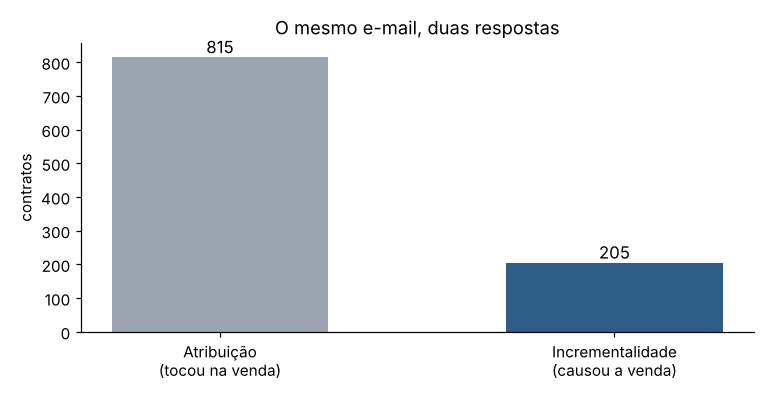
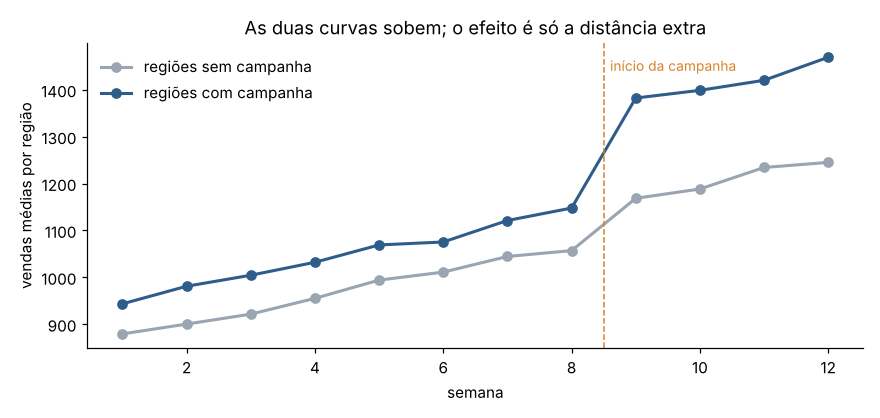

# Incrementalidade na prática

Seu canal de marketing pode estar levando crédito por vendas que aconteceriam de qualquer jeito.

- **Atribuição** responde por onde o cliente passou antes de comprar.
- **Incrementalidade** responde quantas vendas a mais a ação realmente causou.

Este repositório mostra a diferença com **dados sintéticos** (simulados; nenhum dado real de cliente) num notebook curto em Python:

| Parte | Pergunta | Resultado da simulação |
|---|---|---|
| 1. Grupo de controle | Quanto um e-mail de oferta de crédito causou? | A atribuição dá 815 contratos ao e-mail; o efeito real é de cerca de 205 (2,0 p.p., IC 95% de 1,3 a 2,8 p.p.) |
| 2. Sem sorteio | E se o e-mail for só para os clientes engajados? | A comparação ingênua superestima o efeito em cerca de 4 vezes |
| 3. Teste geográfico | Quanto uma campanha regional causou? | "Antes x depois" mostra +35%; a diferença em diferenças mostra +8,7% (efeito real: +8%) |





## Como rodar

```bash
pip install -r requirements.txt
jupyter notebook incrementalidade_na_pratica.ipynb
```

A semente aleatória é fixa (`2026`), então os números se repetem.

## A ideia em uma frase

A pergunta que muda o orçamento não é "quem tocou na venda?". É **"o que teria acontecido sem isso?"**.

---
Evandro de Melo · Cientista de Dados · Marketing Science & Marketing Analytics · [LinkedIn](https://www.linkedin.com/in/evandrodemelo/)
